<div align="center">


# WireForge

### See everything about your network, in one place.

A network and Wi-Fi monitor for Windows, written in **Rust**.
Live traffic, per-app usage, every connection, nearby Wi-Fi and channels, saved Wi-Fi passwords, the devices on your network, a speed test and nine diagnostic tools.

<p>
  
  
  
  
</p>

<p>
  
  
  
  
  
  
</p>

[**Features**](#-features) ·
[**Screenshots**](#%EF%B8%8F-screenshots) ·
[**Download**](#-download) ·
[**Privacy**](#-privacy) ·
[**Limits**](#-good-to-know) ·
[**Developer**](#-developer)

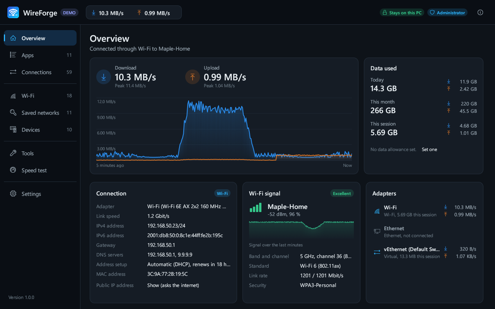

</div>

---

## ✨ Features

<table>
<tr>
<td width="50%" valign="top">

### 📈 Traffic and apps
- Live download and upload rates with history graphs
- Totals for today, this month and this session; optional data allowance alert
- Per-app live rates and usage history (run as administrator for byte counts)
- Every TCP and UDP connection with its program, addresses and state
- Tray icon and an optional floating meter

</td>
<td width="50%" valign="top">

### 📶 Wi-Fi analyzer
- Nearby networks: signal, channel, band (2.4 / 5 / 6 GHz), width, Wi-Fi generation, security, vendor
- Channel occupancy per band with a best-channel suggestion
- Signal over time for your own network
- Full details of the current link

</td>
</tr>
<tr>
<td valign="top">

### 🔑 Saved Wi-Fi networks
- Every network saved on this PC, with its **password**
- Hidden until you press reveal; copy with one click
- QR code to share a network with a phone
- Export, with a clear warning that the file contains passwords
- Says why when a password cannot be shown (for example, work networks that sign in with an account)

</td>
<td valign="top">

### 🖥️ Devices on your network
- Scans your own local network and lists each device: IP, MAC, vendor, name
- First seen and last seen; name and star the ones you know
- Alert when a new device appears
- Only ever scans the network you are directly connected to

</td>
</tr>
<tr>
<td valign="top">

### 🧰 Tools
- Ping with a live graph, and traceroute
- DNS lookup with record types and a chosen server
- Port check, Wake-on-LAN, whois, subnet calculator
- Full interface report
- Flush DNS and renew lease, each behind a confirmation

</td>
<td valign="top">

### ⚡ Speed test
- Download, upload, latency and jitter with a history graph
- Uses Measurement Lab's open NDT7 test
- Asks for consent first, because M-Lab publishes test results (see [Privacy](#-privacy))
- Export any page to CSV, HTML or JSON

</td>
</tr>
</table>

## 🖼️ Screenshots

<table>
<tr>
<td width="50%" align="center"><b>Apps</b><br>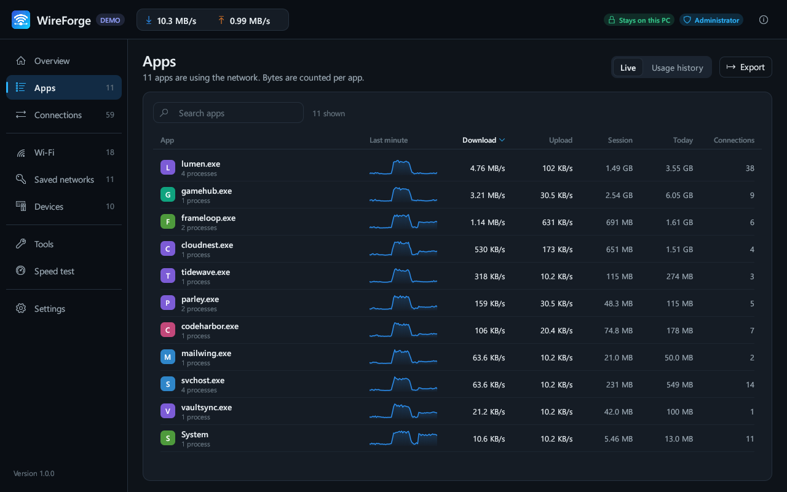</td>
<td width="50%" align="center"><b>Connections</b><br>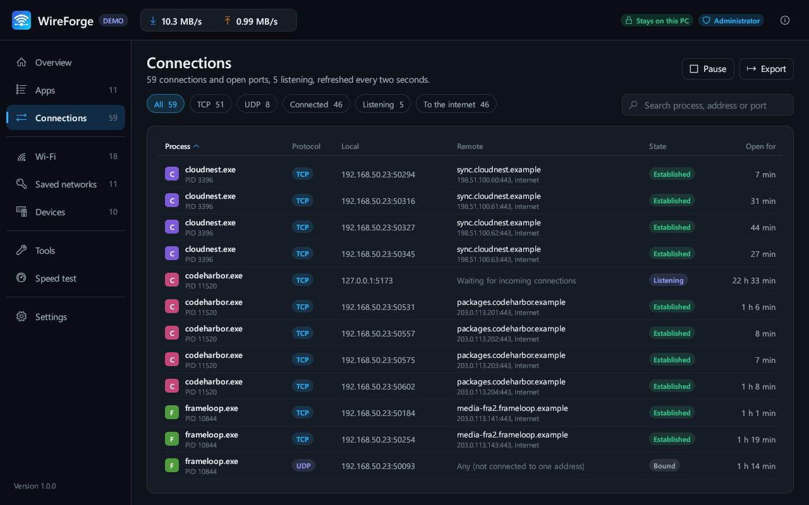</td>
</tr>
<tr>
<td width="50%" align="center"><b>Wi-Fi networks</b><br>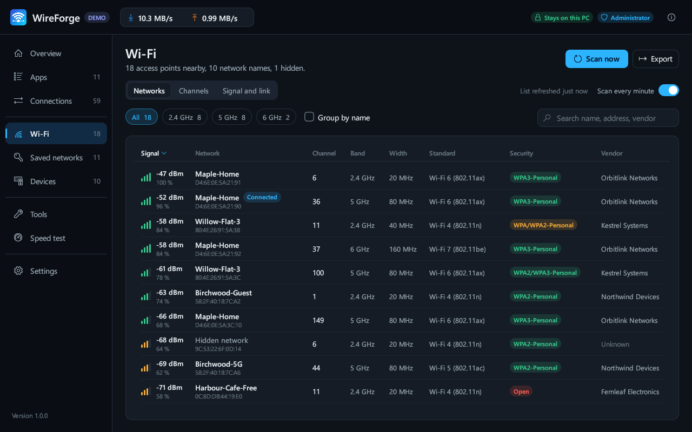</td>
<td width="50%" align="center"><b>Wi-Fi channels</b><br>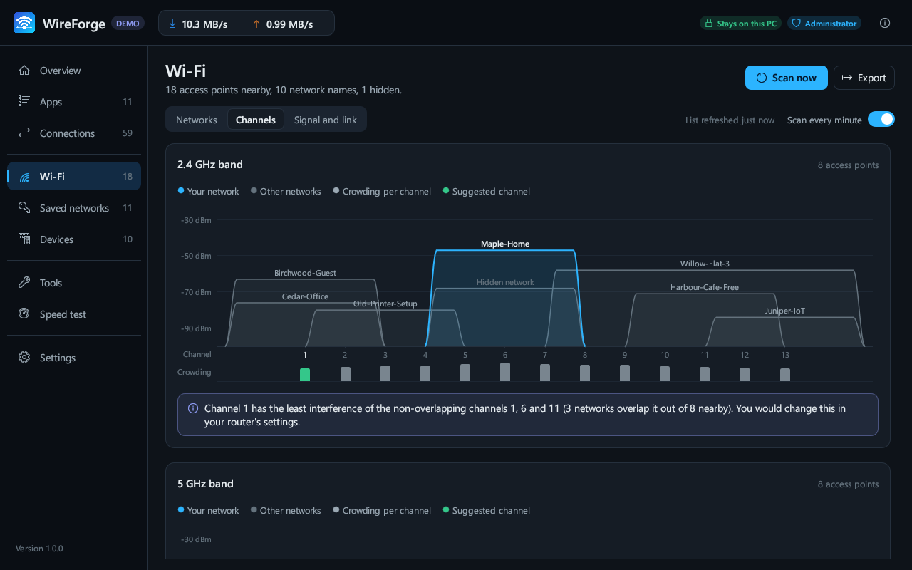</td>
</tr>
<tr>
<td width="50%" align="center"><b>Saved networks and passwords</b><br>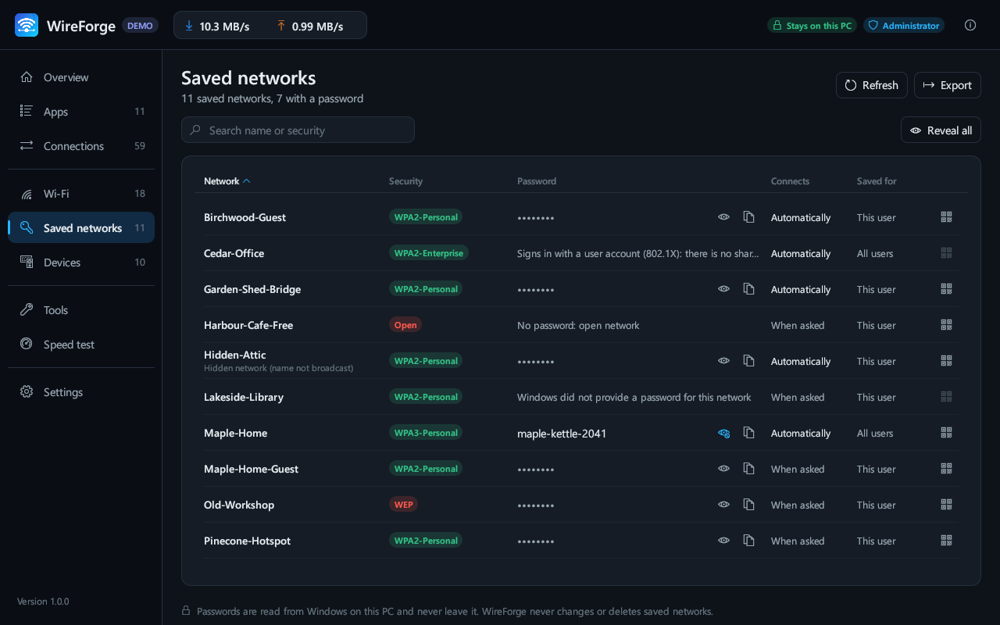</td>
<td width="50%" align="center"><b>Share by QR code</b><br>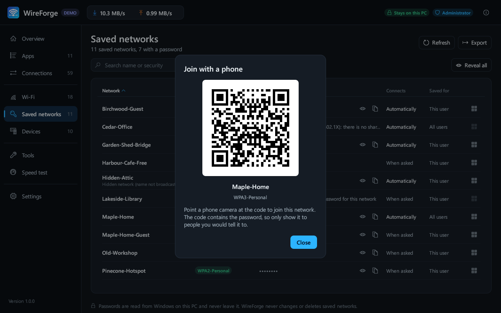</td>
</tr>
<tr>
<td width="50%" align="center"><b>Devices</b><br>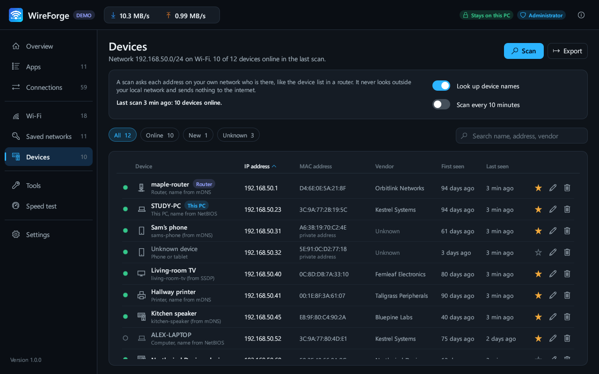</td>
<td width="50%" align="center"><b>Speed test</b><br>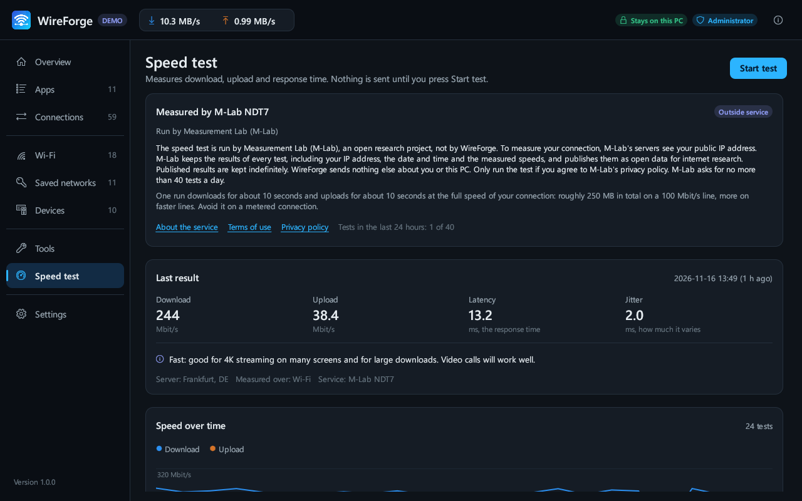</td>
</tr>
<tr>
<td width="50%" align="center"><b>Ping</b><br>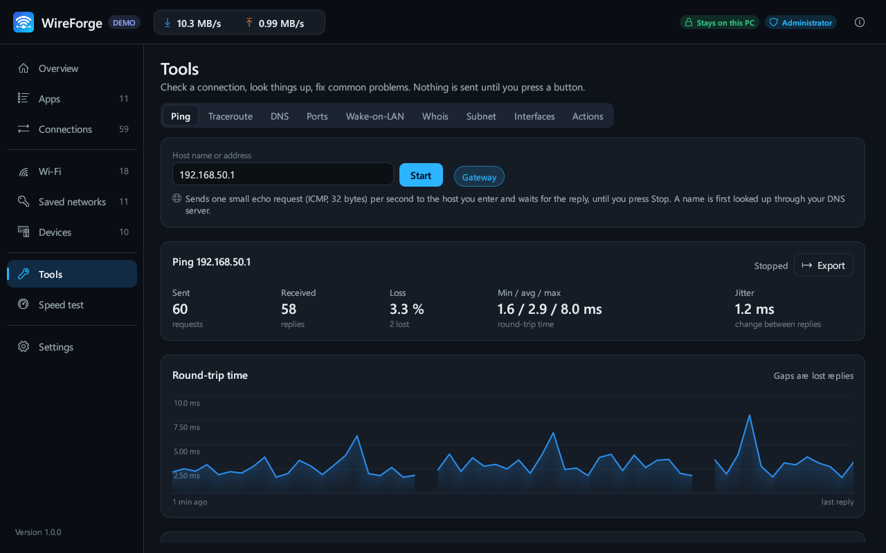</td>
<td width="50%" align="center"><b>Traceroute</b><br>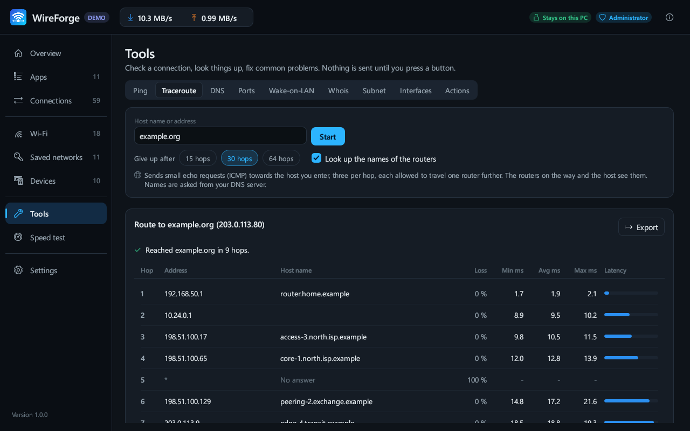</td>
</tr>
<tr>
<td width="50%" align="center"><b>Data usage</b><br>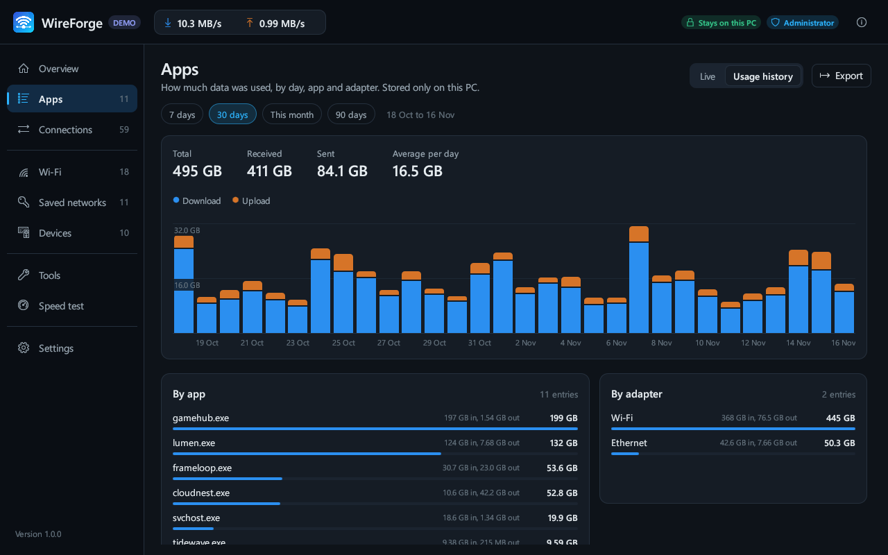</td>
<td width="50%" align="center"><b>Light theme</b><br>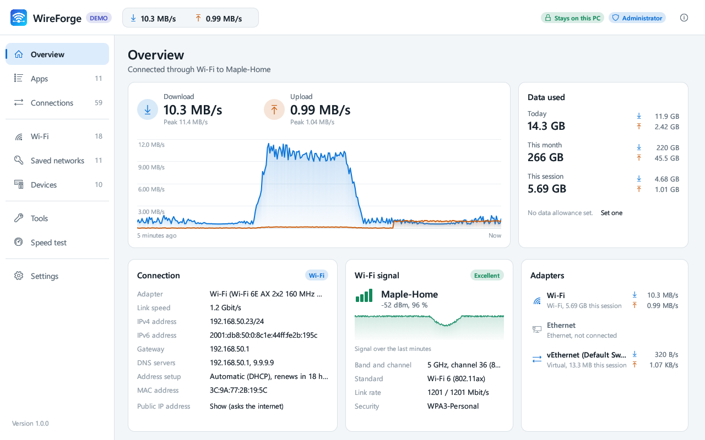</td>
</tr>
</table>

<sub>Screenshots use the built-in demo mode (<code>WireForge.exe --demo</code>). Every network, device, address and password in them is invented.</sub>

## 📥 Download

Get it from the [**latest release**](https://github.com/zheerkhalid/wireforge/releases/latest):

| File | What it is |
|---|---|
| `WireForge-Setup.exe` | Per-user installer with shortcuts and an uninstaller |
| `WireForge-x.y.z-portable-x64.zip` | Portable: unzip and run |
| `WireForge.exe` | The bare 6.4 MB EXE |

WireForge runs without administrator rights. **Restart as administrator** unlocks per-app byte counts and details of every process.

## 🔒 Privacy

Everything WireForge collects stays on your PC. It makes a network request only when you start one:

| Action | Service | What is sent |
|---|---|---|
| Speed test | [Measurement Lab](https://www.measurementlab.net/) NDT7 | Test traffic. **M-Lab publishes results, including your IP address, as open data.** WireForge asks for consent before the first test |
| Show public IP | ipify | A request that reveals your public IP address to that service |
| Ping, traceroute, DNS, whois, port check | The host you name | The request itself |

Saved Wi-Fi passwords are read from Windows on this PC and never leave it. WireForge never changes or deletes saved networks. See [`PRIVACY.txt`](PRIVACY.txt).

Use the device scan and port check only on networks and equipment that are yours or that you are allowed to test.

## 📌 Good to know

- **Per-app byte counts** need administrator rights. In this first release that part has been tested with sample data only, not yet against live traffic.
- Without administrator rights, the Apps page shows connections per app instead of bytes.
- Per-app totals are slightly below adapter totals, because they count payload bytes only.
- The tray tooltip and floating meter show live rates; the tray icon itself does not change.
- Connections are labelled This PC, Local network or Internet; there is no country lookup.
- No kernel driver is installed, so nothing here can block or shape traffic.

## 🏗️ Build from source

Requires Rust (stable, MSVC toolchain) on Windows.

```powershell
git clone https://github.com/zheerkhalid/wireforge
cd wireforge
cargo build --release
# -> target\release\WireForge.exe
cargo test --workspace
```

| Command | What it does |
|---|---|
| `WireForge.exe --demo` | Invented networks, devices and traffic |
| `WireForge.exe --selftest` | Run each collector once and print only success and counts |
| `WireForge.exe --screenshot out.png` | Render the window to a PNG and exit |

```
crates/
  wf-traffic   adapters, connections, per-app usage
  wf-wifi      Wi-Fi scan, saved profiles, device discovery, vendor table
  wf-tools     ping, traceroute, DNS, ports, whois, speed test
src/           the egui interface, charts, tray, export
```

The MAC vendor table comes from the public IEEE listing; see [`NOTICE`](NOTICE). The icon is drawn in code at build time. The C runtime is linked statically, so the EXE runs on a clean Windows install.

## 👨‍💻 Developer

<table>
<tr>
<td align="center" width="140">
  <a href="https://zheer.dev">
    
  </a>
</td>
<td>

**Designed and developed by [Zheer Khalid](https://zheer.dev)**

🌐 Website: **[zheer.dev](https://zheer.dev)**  
🐙 GitHub: **[@zheerkhalid](https://github.com/zheerkhalid)**  
🧩 Also by Zheer: **[SnapForge](https://github.com/zheerkhalid/snapforge)**, **[ReelForge](https://github.com/zheerkhalid/reelforge)**, **[UnForge](https://github.com/zheerkhalid/unforge)**, **[KeepForge](https://github.com/zheerkhalid/keepforge)**, **[ShredForge](https://github.com/zheerkhalid/shredforge)** and **[BootForge](https://github.com/zheerkhalid/bootforge)**

If WireForge is useful to you, a ⭐ on the repo is appreciated.

</td>
</tr>
</table>

## 📄 License

MIT © 2026 [Zheer Khalid](https://zheer.dev). See [`LICENSE`](LICENSE).

<div align="center">
<sub>Built with 🦀 Rust and ❤️ by <a href="https://zheer.dev">zheer.dev</a></sub>
</div>
